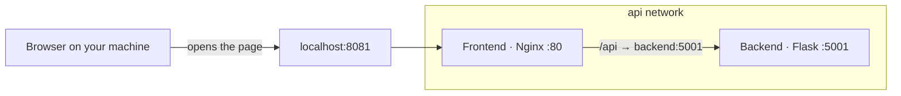

# docker-flask-api

A small Flask API and the page that shows it, each in its own container.

The browser opens one address. Nginx serves the page and forwards `/api` to the Flask app on a private Compose network. The API port is not published on your machine.

## What you get

Open [http://localhost:8081](http://localhost:8081). A skeleton loader holds for 5 seconds, then the page prints the JSON from:

| Method | Path |
| --- | --- |
| GET | `/api/v1/hello` |
| GET | `/api/v1/info` |
| GET | `/api/v2/hello` |

Those paths are relative. The browser calls the Frontend, and Nginx proxies them to `backend:5001`.

## Layout

```text
docker-flask-api/
├── docker-compose.yml
├── backend/          Flask API, port 5001 inside the api network
└── frontend/         Nginx, published as localhost:8081
```

Compose names the images `docker-flask-api-backend` and `docker-flask-api-frontend`.

## Run it

From this directory:

```bash
docker compose build
docker compose up
```

Or both steps at once:

```bash
docker compose up --build
```

Stop it with `Ctrl+C`. Containers started in the background (`docker compose up -d`) stop with:

```bash
docker compose down
```

## Architecture

Compose puts both services on a network named `api`. On that network the Frontend reaches the Backend by the name `backend`. Your machine is not on that network. It only has the published port `8081`, which Compose maps to port `80` in the Frontend.



`/` is the page. `/api/` is proxied to `http://backend:5001` with the path unchanged, so `/api/v1/hello` is still `/api/v1/hello` when it arrives. Port `5001` is not published, so the browser cannot call the Backend directly.

`depends_on` starts the Backend before the Frontend. It does not wait until Flask is ready to accept requests.

## Nginx upstream configuration from the environment

The Frontend image does not hardcode where the API lives. `default.conf.template` is copied to `/etc/nginx/templates/`. When the container starts, the Nginx image substitutes environment variables and writes a normal `default.conf`.

`BACKEND_UPSTREAM` is that address:

| Where it runs | `BACKEND_UPSTREAM` | Why |
| --- | --- | --- |
| Docker Compose | `backend:5001` | The service name exists on the `api` network. `localhost` inside the Frontend is Nginx itself. |
| One ECS Fargate task | `localhost:5001` | Both containers share the task network. The Compose hostname `backend` does not exist there. |

Compose sets the local value in `docker-compose.yml`. A Fargate task definition sets the other one. The image you push to a registry stays the same. Changing the template to a fixed host would make one of the two environments fail.

## License

[Apache License 2.0](LICENSE). Copyright 2026 Michael Serrato.
